# Architecture

[English](ARCHITECTURE.md) | [简体中文](ARCHITECTURE.zh-CN.md)

MusicMC is split into three layers: submission and validation, resource distribution, and synchronized playback.

```mermaid
flowchart LR
    Player["Minecraft player"] -->|"/music upload or netease"| Plugin["Spigot plugin"]
    Plugin -->|"signed short-lived ticket"| Portal["GitHub Pages portal"]
    Portal -->|"ZIP or song ID"| Worker["Cloudflare Worker"]
    Worker -->|"temporary asset and Issue"| GitHub["GitHub repository"]
    GitHub -->|"Issue event"| Actions["GitHub Actions"]
    Actions -->|"validate, fetch, transcode, segment"| Bundler["rolling bundle builder"]
    Bundler --> Storage["GitHub Release or S3-compatible storage"]
    Bundler -->|"catalog v2 commit"| GitHub
    Plugin -->|"public catalog only"| GitHub
    Client["Minecraft client"] -->|"on-demand pack download"| Storage
    Plugin -->|"segment clock and 25-block audience"| Client
```

## Submission layer

The server signs a 15-minute P-256 ticket bound to player UUID, player name, command name, nonce, and `key_id`. The Worker verifies it, enforces one active Issue per player and a global queue cap, then creates a `music-pending` Issue. Actions verifies the signature again. Successful validation publishes immediately; there is no approval state.

ZIP submissions are streamed into a short-lived prerelease. NetEase submissions contain only a song ID; Actions invokes the pinned internal Node adapter with `NETEASE_COOKIE`. The adapter uses normal account playback access and does not expose the Cookie to the portal, Worker, plugin, catalog, or logs.

## Distribution layer

Actions normalizes the source, creates OGG segments of about five seconds, and appends the song to a rolling bundle. A bundle is sealed at 20 songs or before it would exceed 95 MB. Each revision has a new pack UUID and SHA-1. The catalog points all affected songs to the latest revision.

The plugin persists only `catalog-cache.json` and administration metadata. Joining a server does not load all music. `/getcd` and nearby jukebox playback request only the required bundle. Clients download directly from the public asset URL, so audio traffic does not traverse the Minecraft server or FRP.

## Playback layer

The server tracks each active jukebox by song ID, location, start time, current segment, and audience. Every 10 ticks it removes players outside 25 blocks, requests missing packs for new listeners, and starts the next segment for loaded listeners. Audio is normalized for the 25-block packet radius and Minecraft performs positional linear attenuation.

Vanilla clients cannot seek a resource-pack sound. A late listener therefore waits for the next segment instead of hearing from the exact current sample. Precise seamless seeking requires a client mod.

## Failure behavior

- A failed catalog fetch leaves the last valid cached catalog active.
- Pack requests try configured proxy candidates and then the direct URL.
- Failed processing never commits a catalog entry and marks the Issue `music-failed`.
- NetEase tickets bind the provider ID directly. The page prefers the Worker's signed, fixed-upstream metadata endpoint and can use the fixed `apis.netstart.cn` HTTPS endpoint for read-only metadata when `workers.dev` is unreachable. Neither path carries the Cookie, and the Worker plus Actions still revalidate publication; `NETEASE_COOKIE` remains confined to GitHub Actions Secrets.
- Bundle and song versions use immutable asset paths; already cached content remains usable during an upstream outage.
- Replacing a song retains its `song_id` and increments `revision`, so existing physical discs resolve to the new catalog entry.
