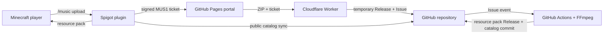

# Architecture

[English](ARCHITECTURE.md) | [简体中文](ARCHITECTURE.zh-CN.md)

## Components



The repository is the durable state store. `catalog.json` is the only index the
Minecraft plugin needs. Song packs and source archives are immutable GitHub
Release assets.

## Trust boundaries

- The Minecraft server owns a P-256 private key and signs short-lived tickets.
- The matching public key is committed for Actions and installed as a Worker binding.
- The upload page has no secret and cannot create arbitrary valid tickets.
- The Worker owns a repository-scoped GitHub token and accepts requests only from the configured Pages origin.
- Actions re-verifies every ticket before reading the ZIP or publishing a song.
- ZIP paths, compression ratio, file count, extension, size and duration are validated before FFmpeg runs.
- The plugin validates resource-pack SHA-1 and source-archive SHA-256 values from the catalog.

## Submission states

```text
music-pending -> music-processing -> music-ready
                                 \-> music-rejected
```

The Worker first creates a prerelease named `upload-<ticket nonce>` and uploads
the ZIP as a fixed-length stream. It then creates the processing Issue. The
workflow deletes the temporary release after success or rejection.

## Failure behavior

- Catalog synchronization retains the last valid local catalog when all mirrors fail.
- Resource-pack downloads try configured proxies and then direct GitHub URLs.
- A failed upload never publishes a catalog entry.
- Duplicate normalized song names and reused ticket nonces are rejected.
- Worker requests without configuration, a matching CORS origin, valid length or valid signature fail closed.
