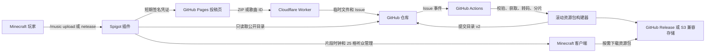

# 架构说明

[English](ARCHITECTURE.md) | [简体中文](ARCHITECTURE.zh-CN.md)

MusicMC 分为三层：投稿与校验、资源包分发、同步播放。

## 投稿层

服务器用 P-256 私钥签发 15 分钟凭证，绑定玩家 UUID、玩家名、命令名称、一次性 nonce 和 `key_id`。Worker 验证后执行“每名玩家同时 1 个任务”和全服队列上限，再创建 `music-pending` Issue。Actions 会再次验签。自动校验成功后直接发布，没有人工批准状态。

ZIP 投稿先流式写入短期预发布。网易云投稿只传歌曲 ID，Actions 使用固定版本的内部 Node 适配器和 `NETEASE_COOKIE`。Cookie 不会进入网页、Worker、插件、目录或日志。

## 分发层

Actions 规范化音频并切成约 5 秒的 OGG 片段，再合入当前滚动资源包。一个包达到 20 首或接近 95 MB 时封包。每次修订使用新的资源包 UUID 和 SHA-1，目录中的相关歌曲指向最新修订。

插件只持久化 `catalog-cache.json` 和管理元数据。玩家进服不会加载全部歌曲；执行 `/getcd` 或靠近播放中的唱片机时，才请求所需资源包。客户端直接从公开资源地址下载，因此音频流量不经过 Minecraft 服务器和 FRP。

## 播放层

服务器为每台活动唱片机记录歌曲 ID、位置、开始时间、当前片段和听众集合。每 10 tick 移除 25 格外玩家，为新听众请求缺少的包，并在下一个片段开始时让已加载玩家加入。音频按 25 格数据包半径预先归一化，由 Minecraft 客户端执行位置线性衰减。

原版客户端不能把资源包声音跳到指定采样位置，因此后来进入范围的玩家要等下一个片段。完全无缝并支持任意进度只能依靠客户端 Mod。

## 故障行为

- 所有目录地址失败时，插件继续使用最后一份有效缓存。
- 资源包请求依次尝试配置的代理和直接地址。
- 自动处理失败不会提交目录，并把 Issue 标记为 `music-failed`。
- 网易云投稿凭证直接绑定歌曲 ID。网页只通过 Worker 的固定上游、签名保护接口查询标题和歌手；`NETEASE_COOKIE` 仍只存在于 GitHub Actions Secrets 中。
- 资源包与歌曲版本使用不可变地址；上游短时故障时，已经缓存的内容仍可播放。
- 替换音频会保留 `song_id` 并递增 `revision`，已有实体唱片会自动解析到新版本。
