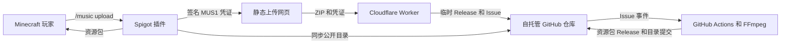

# 架构说明

[English](ARCHITECTURE.md) | [简体中文](ARCHITECTURE.zh-CN.md)

## 组件



仓库是持久状态存储。Minecraft 插件只需要 `catalog.json`；歌曲资源包和源压缩包保存在不可变的 GitHub Release 资产中。

## 信任边界

- Minecraft 服务器持有 P-256 私钥，并签发短期上传凭证。
- 对应公钥提交到自托管仓库并配置为 Worker 绑定。
- 上传网页不保存 Secret，也无法伪造有效凭证。
- Worker 使用仅授权自托管仓库的 GitHub Token，并只接受配置来源的 CORS 请求。
- Actions 在读取 ZIP 或发布歌曲前再次验证凭证。
- FFmpeg 运行前会校验 ZIP 路径、压缩率、文件数量、扩展名、大小和时长。
- 插件依据目录校验资源包 SHA-1 和源压缩包 SHA-256。

## 提交状态

```text
music-pending -> music-processing -> music-ready
                                 \-> music-rejected
```

Worker 先创建 `upload-<凭证 nonce>` 预发布并流式上传 ZIP，再创建处理 Issue。工作流在成功或拒绝后删除临时 Release。

## 失败行为

- 所有镜像失败时，目录同步继续使用最后一份有效本地目录。
- 资源包下载先尝试配置代理，再尝试 GitHub 直连。
- 上传失败不会写入歌曲目录。
- 规范化后重名的歌曲和重复凭证会被拒绝。
- Worker 缺少配置、来源不符、长度无效或签名无效时会默认拒绝请求。
